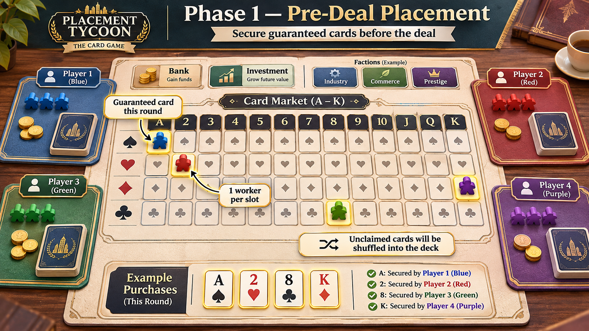
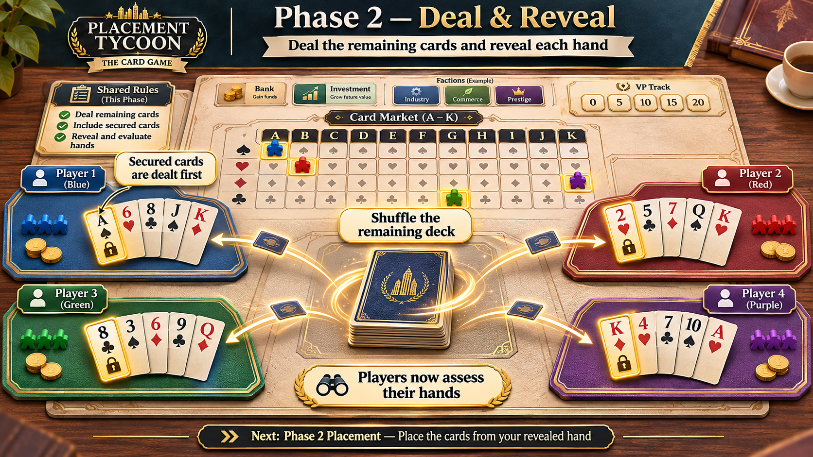
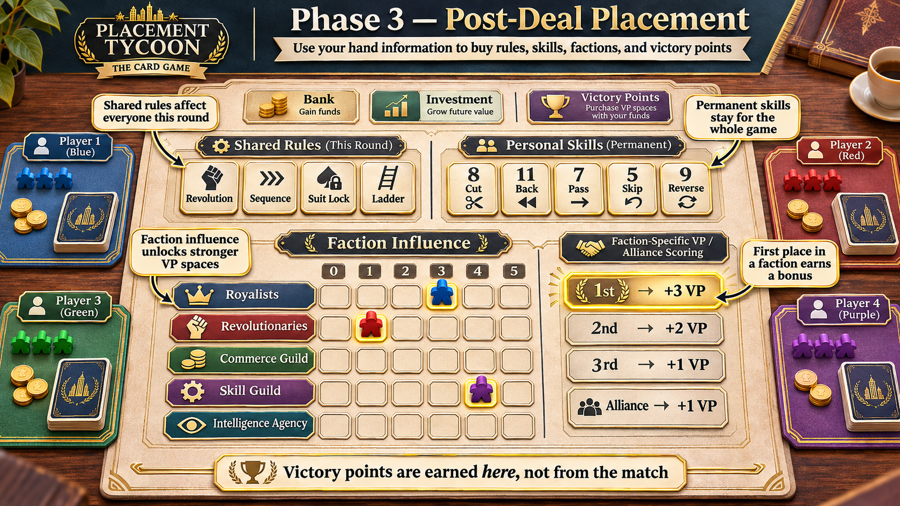
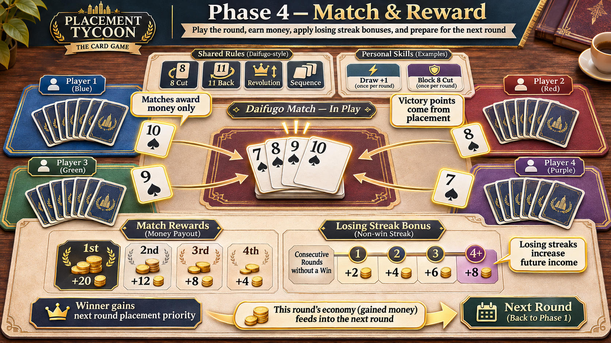

# Placement Tycoon: The Card Game

**大富豪で稼ぎ、配置で勝つ。**

大富豪に、ワーカープレイスメントとラウンド間のエコノミーを組み合わせた対戦ゲーム。強いカードを買うか、スキルや派閥を育てるか、今回はエコにして勝利点へ投資するかを選ぶ。

> **設計段階**: 現在はREADMEと設計書のみ。ゲーム本体は未実装。
> 試作の基準は **4人・15ラウンド・初期5ワーカー／最大7ワーカー**。数値・細則は調整中。

## フェーズ別イメージ

ゲームの流れを示す4枚のコンセプト図。画像ファイルは [`docs/images/`](docs/images/) に収録している。

> 図中のカード表記・派閥名・スキル分類・VP例には、現行設計と異なるものがある。ルールは本文と[設計書](docs/README.md)を参照。

### Phase 1: カード確保

配布前にワーカーとお金を使い、今ラウンドに欲しいカードを確保する。

### Phase 2: 手札配布・確認

確保カードを受け取り、残りのカードをシャッフルして手札を補充する。手札は本人だけが確認し、図の公開表示は説明用。

### Phase 3: 戦略配置

手札を見て、残りのワーカーを共有ルール・個人スキル・派閥・銀行・投資・勝利点へ配置する。同盟VPは首位の保持中だけ得る得点で、図の順位別VP表は採用ルールではない。

### Phase 4: 大富豪・精算

大富豪で順位賞金と連敗ボーナスを得て、資金を次ラウンドへ持ち越す。試合からVPは得られない。8切り・11バックは共有ルールではなく、購入・装備した個人スキルとして使う。

## 簡単なルール

### 勝利条件

規定ラウンド終了時に、最も多くの勝利点（VP）を持つプレイヤーが勝利。

**大富豪の試合で得るのはお金と次回の配置順。試合順位・連勝からVPは得られない。** VPは一般・派閥専用マスへの配置と、派閥の同盟トークンで獲得する。

### 1ラウンドの流れ

1. **準備** — 投資の配当を受け取り、主契約する派閥を選ぶ。前の試合の順位順に配置する。
2. **カード確保** — 1手ずつワーカーとお金を使い、欲しいカードを予約する。A〜Kの全13ランクに、4スート分の枠がある。
3. **手札配布** — 確保カードを本人へ渡し、残りをシャッフルして補充する。確保分は手札枚数の内数であり、追加の手札ではない。
4. **戦略配置** — 手札を見てから、共有ルール・個人スキル・派閥支援・銀行・投資・勝利点などへ配置する。配布前後で同じワーカーを使い、途中で回復しない。
5. **大富豪** — 今回の共有ルールと各人の装備スキルを使って対戦し、手札を出し切った順に試合順位を決める。
6. **精算** — 順位賞金と連敗ボーナスを受け取り、資金を次へ持ち越す。ワーカーを回収し、次ラウンドへ進む。

各配置マスには定員があり、先に埋まれば使えない。最初の人が全ワーカーをまとめて置くのではなく、1個ずつ交互に置く。

### 何を買うか

| 対象 | 役割 | 持続期間 |
| --- | --- | --- |
| カード確保 | A・2・♠3など、欲しい札を初期手札に入れる | 今ラウンドのみ |
| 共有ルール | 階段・縛り系・革命を**全員**に解禁 | 今ラウンドのみ |
| 個人スキル | 8切り・11バック・7渡し・5スキップ・9リバース | 所有は永続。装備して使用 |
| 派閥支援 | 影響力、能力、専用VPマスへのアクセスを育てる | 永続 |
| 銀行・投資 | 銀行は即金、投資は次ラウンド以降の配当 | 投資は永続 |
| 勝利点 | 資金と配置機会を得点へ変える | 累積 |

8などの特殊効果は、スキルを持たなければ使えない。革命を購入しても即座に強弱が逆転するのではなく、その試合で4枚出しによる革命が可能になる。

## 5つの派閥

| 派閥 | 得意分野 |
| --- | --- |
| 王党派 | A・2・Kなどの強いカードを確保 |
| 革命派 | 共有ルールを購入して環境を変える |
| 商業ギルド | 銀行と投資で資金を形成 |
| 技能ギルド | 永続スキルと装備枠を強化 |
| 諜報組織 | 配布後の情報収集とカード交換 |

配置で影響力を上げ、派閥専用のVPマスを解禁する。条件を満たした影響力首位は同盟トークンの追加VPを持ち、追い抜かれるとトークンとVPを失う。**同盟VPは保持中だけの得点で、毎ラウンド累積するものではない。**

さらに派閥全体が発展すると、所属・主契約に関係なく全プレイヤーへ共有効果が及ぶ。自分への投資がライバルを助けることもある。

## 設計書

**[設計ドキュメント一覧](docs/README.md)**

| 文書 | 内容 |
| --- | --- |
| [ゲーム設計書](docs/game-design.md) | 全体像、フェーズ、勝利条件、採用・未決定事項 |
| [派閥設計](docs/factions.md) | 個人バフ、共有効果、影響力、同盟、派閥VP |
| [経済・バランス](docs/economy-and-balance.md) | 価格、賞金、連敗ボーナス、銀行・投資、検証計画 |
| [カードルール](docs/rules-and-timing.md) | 基礎ルール、特殊効果、処理順 |
| [実装方針・テスト](docs/implementation-plan.md) | 状態モデル、情報公開、受け入れ条件 |

ジョーカーの購入方式、最終試合の賞金を使う得点配置、方縛り・両縛りの細則は未決定。採用した仕組みと、試作用の価格・閾値を設計書で区別している。

## ライセンス

[MIT License](LICENSE)
