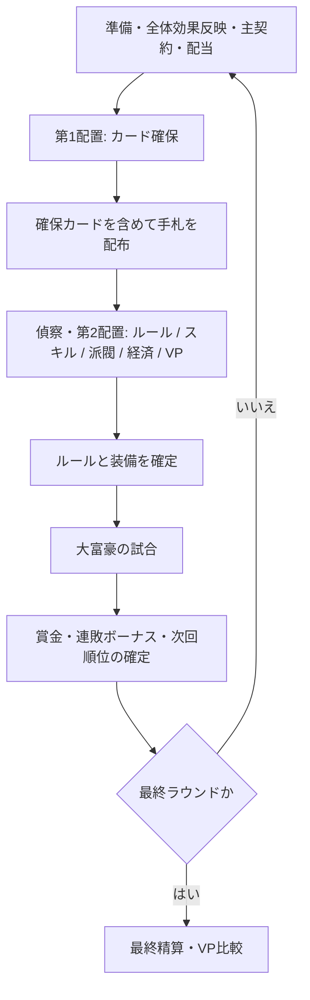

# Placement Tycoon: The Card Game — ゲーム設計書

仕様バージョン: 0.1 / 状態: 実装前・バランス未検証

> 大富豪で資金を稼ぎ、ワーカーで資金の使い道を選び、派閥と勝利点を取り合う。
> **大富豪の1位は、そのままゲーム全体の勝者ではない。**

[設計書一覧](README.md) / [プロジェクト概要](../README.md)

## 1. コンセプト

大富豪の手札処理を、ラウンド間の経済管理とワーカープレイスメントで接続する対戦ゲーム。

- **手札への投資**: 配布前に欲しいカードを確保し、運を部分的に制御する。
- **環境への投資**: 配布後の手札を見て、その試合に適した共有ルールを解禁する。
- **永続的な成長**: 個人スキル、派閥影響力、投資、ワーカー増員を育てる。
- **得点への転換**: 資金だけでなく、配置枠・ワーカー・手番順を使ってVPを得る。
- **エコの判断**: 今回の試合への出費を抑え、資金や配置機会を将来に回す。

デッキを恒久的に強化する方式ではない。通常カードは各ラウンドで全回収され、再配布される。永続するのはスキル、影響力、投資などである。

## 2. 決定の状態

本書では、会話で採用した仕組みと、検証のために補った細則を区別する。

| 区分 | 意味 |
| --- | --- |
| 採用 | ゲームの方向性として採用した仕様 |
| 試作案 | 初期テスト用の数値・処理。変更可能 |
| 未決定 | 複数案があり、採用が決まっていない事項 |

### 採用した骨格

| 項目 | 方針 |
| --- | --- |
| 正式名称 | Placement Tycoon: The Card Game |
| 全体の勝敗 | 規定ラウンド終了時のVPで決定する |
| 試合順位の報酬 | お金のみ。試合順位・連勝からVPは発生しない |
| 経済 | 資金持ち越し、連敗ボーナス、銀行、投資を持つ |
| カード市場 | A〜Kの全13ランク、各ランクに4スート分の確保枠 |
| 配置の順序 | 1手ずつ順番に置く。前の試合の順位を次ラウンドの配置順に使う |
| 配布前 | カードを確保する |
| 配布後 | 手札を確認して共有ルールを購入する |
| 個人スキル | 8切り・11バック・7渡し・5スキップ・9リバースなどを永続獲得する |
| 共有ルール | 階段・縛り系・革命などを、そのラウンドだけ全員に解禁する |
| 派閥 | 5派閥、影響力トラック、個人バフ、全体共有効果 |
| 派閥の得点 | 専用VP配置マスと、影響力首位の追加ポイント |

### 試作の基準値

4人、15ラウンド、初期ワーカー5個・最大7個を基準に検討する。これらと各価格は確定値ではない。数値の正本は [経済・バランス設計](economy-and-balance.md) とする。

## 3. 用語と資源

| 用語 | 定義 |
| --- | --- |
| ゲーム | 複数ラウンドで構成される全体の対戦 |
| ラウンド | 準備、配置、配布、大富豪1試合、精算までの周期 |
| 配置手番 | ワーカー1個を配置する機会 |
| 試合手番 | 大富豪でカードを出す、またはパスする機会 |
| 場 | カードが出され、全員のパスや8切りなどで流れるまでの単位 |
| G | 購入、派閥支援、投資、VP獲得に使う資金 |
| VP | ゲーム全体の勝敗を決める勝利点 |
| 影響力 | プレイヤーごとの、各派閥に対する永続的な進行度 |
| 主契約 | そのラウンドに個人バフを使う派閥。1つを選ぶ試作案 |
| 同盟トークン | 派閥首位が保持する、移動可能な追加VP |

所持金、VP、影響力、スキル所有、投資、ワーカー、購入済みカード、配置先は公開。配布後の手札と非公開の偵察結果は本人だけが確認する。公開情報から推測できるカードはあるが、手札全体が公開されるわけではない。

## 4. ラウンドの流れ



### 4.1 準備

1. 前ラウンドに配置したワーカーを回収する。
2. 前ラウンドに解禁条件へ到達した派閥の共有効果を有効化する。
3. 前の試合順位から配置順を設定する。初回は無作為に決める試作案。
4. 主契約を選ぶ。配布前に固定し、試合中には変更しない。
5. 前ラウンド以前に保有した投資から配当を受け取る。
6. ラウンド限定の使用回数、予約、ルール、配置枠を初期化する。

試合賞金は前ラウンド末に支払う。ここで同じ賞金を二重に支給しない。

### 4.2 第1配置: カード確保

各人が配置順に、1個ずつワーカーを使ってカードを確保する。先行プレイヤーが全ワーカーを一度に置くわけではない。

通常カードは「ランク × スート」の52マス。1つの物理カードに対応するマスは1ラウンドに1人だけが利用できる。同一プレイヤーの同ランク確保は1枚までとする試作案により、4人全員が同じランクを購入できる機会を残す。

第1配置を終了するパスを選べる。パスした人はこのフェーズへ戻れないが、未使用ワーカーと資金は第2配置へ持ち越す。全員が終了したら配布する。

**第1・第2配置は同じワーカープールを共有する。配布時にワーカーを回復させない。**

### 4.3 配布

試作では通常52枚とジョーカー2枚を母集団とし、4人へ各13枚、残り2枚を未配布プールとする。

購入済みカードを先に取り分け、残りをシャッフルして、各人の手札が合計13枚になるまで補充する。確保カードが3枚ならランダム配布は10枚。購入により手札総数が増えることはない。

購入済みカードは必ず本人の初期手札に含める。その後の合法な交換や7渡しで移動することまでは禁止しない。

ジョーカー購入の方法は未決定。競りが候補であり、先着で常に同じ人へ渡る販売は避ける。最初の動作検証では予約販売を無効にしてランダム配布する案を使える。

### 4.4 偵察と第2配置

まず、適用対象なら諜報組織の公開・個人偵察を解決する。個人偵察は配置順で処理する試作案。

その後、各人は残りのワーカーを1個ずつ使い、次を選ぶ。

| 配置先 | 狙い |
| --- | --- |
| 共有ルール | 自分の手札が活きる試合環境にする |
| 個人スキル | 今回と将来の試合で使う能力を得る |
| 派閥支援・外交 | 影響力、個人バフ、VPアクセス、同盟を狙う |
| 銀行 | 即時に資金を得る |
| 投資 | 次ラウンド以降の配当を買う |
| ワーカー増員 | 将来の配置回数を増やす |
| 一般VP・派閥VP | 今回の試合への投資を抑えて得点する |

カード市場を再度利用することはできない。原則として各専用マスは1枠。銀行・投資・外交など複数枠を設けるものは、個別に容量を定義する。

共有ルールは**購入した本人だけでなく全員**に適用する。革命の購入は「4枚出しで革命できる権利を全員に解禁する」ことであり、その時点で強弱を反転させるものではない。

### 4.5 試合の準備確定

今回有効な共有ルール、各人の装備スキル、主契約バフ、カード枚数を確認する。

スキルは永続所有するが、装備数には上限を置く試作案。第2配置で購入したスキルは、空き装備枠があれば今回から使用できる。派閥の個人バフはラウンド開始時の契約・影響力スナップショットを用い、途中の影響力増加による新段階は次ラウンドから反映する。

### 4.6 大富豪の試合

手札を先に出し切った順に試合順位を決める。基礎ルールと特殊効果の細則は [カードルールとタイミング](rules-and-timing.md) に分離する。

9リバースによる方向変更は、この試合内にのみ作用する。ワーカーの配置順をその場で逆転させない。

### 4.7 精算

試合順位に応じた基本賞金と、条件を満たす連敗ボーナスを支払う。1位の連敗カウントはリセットし、次回の配置先行権を与える。

**試合勝利・試合順位・連勝を理由とするVPの支給はない。** 通常カード、共有ルール、場の状態をリセットし、永続要素と未使用資金を維持する。

最終ラウンドだけは「賞金を得た後に使い道がない」問題がある。最終得点配置を設けるかは未決定であり、後述の論点を解決してから完全なプレイ可能ルールとする。

## 5. 購入対象と持続期間

| 対象 | 持続期間 | ラウンド終了後 |
| --- | --- | --- |
| 通常カード・ジョーカーの確保 | 今ラウンドだけ | 全カードを回収して再配布 |
| 革命・階段・縛りなどの共有ルール | 今ラウンドだけ | 解禁状態を解除 |
| 個人スキルの所有 | ゲーム終了まで | 所有を維持、装備は次回再選択 |
| 派閥影響力・獲得した能力段階 | ゲーム終了まで | 維持 |
| 主契約の選択 | 1ラウンド | 次回選び直す |
| 解禁された派閥共有効果 | ゲーム終了までの試作案 | 全員に継続適用 |
| 投資・増員 | ゲーム終了まで | 維持 |
| 資金 | ゲーム終了まで | 持ち越し |
| 購入済みVP | ゲーム終了まで | 累積 |
| 同盟VP | トークン保持中だけ | 首位交代時に移転 |

## 6. 得点設計

得点経路は、一般VP配置、派閥専用VP配置、派閥同盟に整理する。

```text
表示VP = 累積した配置VP + 現在保持する同盟トークンのVP
```

同盟VPは累積ポイントではない。2VPの同盟がAからBへ移るならAは2VPを失い、Bが2VPを得る。奪い返すたびに2VPが増殖してはならない。

派閥影響力2で固定1VPを得る案も過去に挙がったが、明示採用されていない追加案として保留する。v0.1では既定OFFとし、導入する場合は配置による影響力上昇に紐づく別得点として記録する。

現金の自動VP換算、試合終了時の手札枚数によるVP、連勝VPは設けない。同点の扱いは未決定。最初の検証では同点優勝とし、現金タイブレークを無断で加えない。

## 7. 派閥

| 派閥 | 専門 |
| --- | --- |
| 王党派 | A・2・Kなど高ランクカードの確保 |
| 革命派 | 革命・階段・縛りなどの共有ルール操作 |
| 商業ギルド | 銀行・投資・資金形成 |
| 技能ギルド | 永続スキルと装備枠 |
| 諜報組織 | 未配布カードの情報・交換 |

最初に所属を固定せず、配置を通じて複数派閥の影響力を育てられる。個人バフ、共有効果、派閥VPアクセス、同盟保持は別の概念として扱う。詳細は [派閥設計](factions.md)。

## 8. エコラウンドの位置付け

エコとは、試合への投資を抑えて資金やワーカーを得点・成長へ回す選択である。カードプレイを放棄したり、必ず最下位を取ったりすること自体を報酬化したいわけではない。

試合で勝つ価値は、増えた賞金と次回配置順の価値から、勝つための追加費用・配置機会費用を引いて評価する。敗者の回復は保証したいが、永遠に試合を捨てることだけが最適にならないよう検証する。

## 9. 未決定事項と重要なリスク

| ID | 論点 | 方針・比較案 |
| --- | --- | --- |
| O-01 | 最終ラウンド賞金の使い道 | 推奨試行案: 最終回だけVP配置を試合後へ移し、同じ残りワーカーで最終得点配置を行う。まだ未採用 |
| O-02 | ジョーカー購入 | 2枚の封印競り、均等アクセス制、予約販売なしを比較。競りなら同額処理・敗者費用・資金公開との整合も必要 |
| O-03 | 縛り系の厳密な意味 | 「方縛り」を含む会話中の名称と、スート・枚数・数字の条件を明示してから実装する |
| O-04 | 同時に有効な共有ルール数 | 最大3種案は未確定。無制限案と比較し、枠埋めによる革命封じを検証 |
| O-05 | ゲーム時間 | 15試合と配置フェーズの長さを実測。短縮プリセットの必要性を判断 |
| O-06 | 永続成長の雪だるま化 | 投資・増員・割引の早期購入が自動的な最善手になっていないか確認 |
| O-07 | 先行権の固定化 | 同盟争奪の外交マスと、VP枠の容量・価格で調整 |
| O-08 | 大富豪の細則 | 階段とスキルの合成、反則上がり、初手、パス復帰などを試作設定から確定 |
| O-09 | 最終同点 | 同点優勝、現金比較などから選択。現金比較はエコを有利にする点に注意 |

## 10. 設計の完了条件

この文書群は採用方針と試作設定を記録したもので、ゲームの実装完了やバランスの保証ではない。

次の検証では、同じ乱数条件でカード投資・エコ・派閥成長・直接VPの各方針を比較し、資金収支、VP効率、配置順の価値、最終試合の意味、所要時間を測定する。実装時の状態分離と受け入れ条件は [実装方針・テスト](implementation-plan.md) に記載する。
